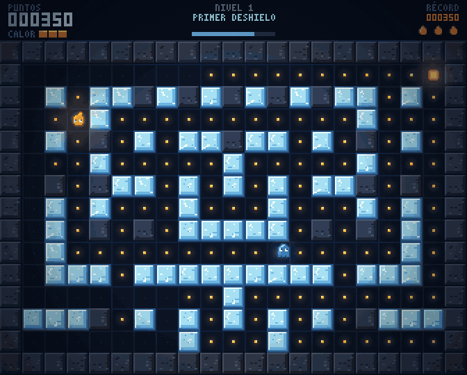
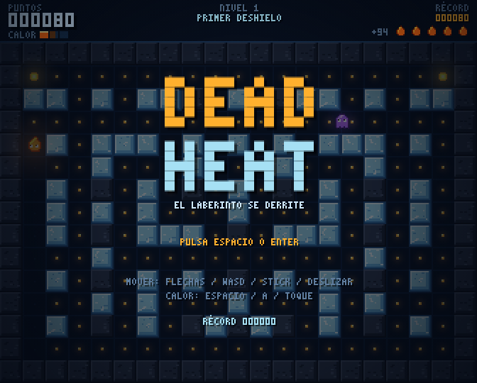
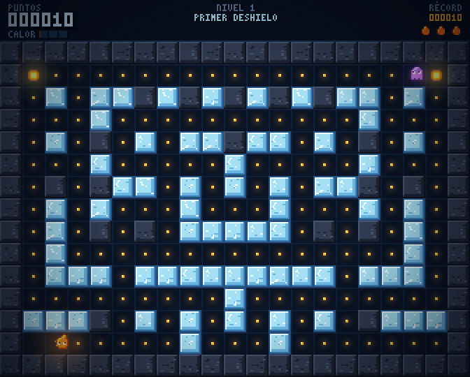
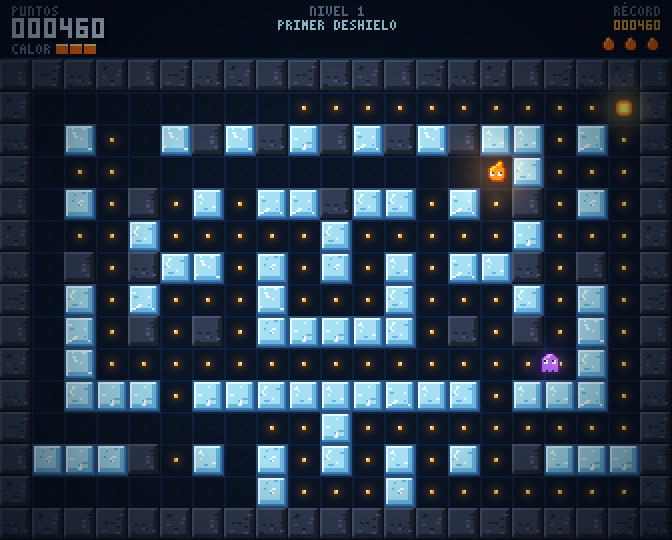

# Dead Heat

**Pac-Man donde el laberinto lo cambias tú.** Recoges brasas para limpiar el nivel, y esas mismas brasas son tu herramienta: derriten los muros de hielo, abren atajos y sueltan agua que se vuelve contra los enemigos.

Un juego de laberinto en HTML5 + Canvas, un único `index.html` sin dependencias ni archivos externos. Gráficos de píxel art dibujados por código y sonido y música sintetizados con Web Audio.

| | |
|---|---|
|  |  |
|  |  |

## Cómo se juega

Eres una llama pequeña en un laberinto de hielo. Para pasar de nivel hay que recoger todas las brasas.

- **Brasas.** Cada una vale 10 puntos. Cada 5 brasas se carga una unidad de **calor**.
- **Calor.** Pulsa la acción para gastar una carga: derrite el primer bloque de hielo que tengas a dos casillas o menos en la dirección en que miras, y los cuatro bloques de hielo que lo rodean. La roca oscura no se derrite.
- **Agua.** El hielo derretido se convierte en agua que se reparte por los pasillos. Te frena un tercio, frena a los enemigos y hace correr más al patinador. Pasados unos segundos vuelve a congelarse, pero solo en casillas donde el laberinto sigue siendo recorrible entero. Así el mapa cambia durante la partida sin dejar nunca zonas aisladas.
- **Brasa grande.** Durante 7 segundos los enemigos se vuelven azules y lentos, y puedes comértelos (200, 400, 800 y 1600 puntos en cadena). También te da una carga de calor.
- **Calor contra enemigos.** Si la descarga alcanza a un enemigo sobre agua, se evapora (400 puntos). En seco, solo lo aturde 2,5 segundos. Un enemigo que pisa agua a punto de congelarse queda helado 4 segundos y no hace daño.
- **Vidas.** Empiezas con 3 vidas de reserva. Si pierdes la última, se acaba la partida. Completar un nivel da 500 puntos más 100 por cada vida de reserva.
- **Récord.** Se guarda en `localStorage` del navegador.

### Enemigos

| Enemigo | Color | Comportamiento |
|---|---|---|
| Gélido | Violeta | Te persigue por el camino más corto. Cada cierto tiempo se retira a su esquina. |
| Patinador | Verde | Se lanza en línea recta hasta chocar y elige entonces la dirección que más le acerca a ti. Sobre agua corre mucho más. |
| Grieta | Rosa | Merodea a media distancia. Cada pocos segundos marca una casilla cerca de ti y, tras un aviso parpadeante, la convierte en hielo. |

### Niveles

Cinco niveles diseñados, cada uno con más hielo, más enemigos y menos tiempo antes de que el agua se congele: Primer deshielo, Patinaje, Grietas, Cuarto frío y Calor muerto. Después, el último nivel se repite con velocidad creciente. Los laberintos se generan con semilla, son simétricos y siempre conexos.

## Controles

| Acción | Teclado | Mando | Táctil |
|---|---|---|---|
| Mover | Flechas, WASD | Stick o cruceta | Deslizar |
| Calor | Espacio, Z, X, Mayús | A, X, RB, RT | Tocar |
| Pausa | P, Esc | Start | (se pausa al salir de la pestaña) |
| Sonido | M | | |

## Ejecutar

Abre `index.html` en el navegador. Para publicarlo en GitHub Pages basta con subir el archivo a la raíz del repositorio y activar Pages sobre la rama principal.

## Estructura

`index.html` se genera a partir de `src/` con `python3 build.py`. Las fuentes se reparten por secciones para poder migrar a otro motor sin reescribir la lógica:

| Archivo | Contenido |
|---|---|
| `src/01-sim.js` | Generador de laberintos, datos de niveles y estado de partida. Sin dibujo, con semilla. |
| `src/02-step.js` | Paso fijo de simulación: movimiento, calor, agua, enemigos y colisiones. |
| `src/03-audio.js` | Efectos y música por capas con Web Audio. |
| `src/04-input.js` | Teclado, mando y táctil en una única capa de entrada. |
| `src/05-gfx.js` | Fuente de píxeles, sprites, baldosas y partículas. |
| `src/06-render.js` | Dibujado del mundo, luces y HUD. |
| `src/07-game.js` | Escenas, bucle, guardado y piloto automático. |

La simulación corre a 60 pasos por segundo independientes del dibujado y no depende del navegador, así que se puede ejecutar en Node para pruebas, repeticiones o modos con semilla compartida.

## Pruebas

Todo lo siguiente se ejecutó en un Chromium sin interfaz y en Node (`test/`):

- **Laberintos:** 4200 niveles generados (600 semillas × 7 niveles) sin una sola casilla de suelo aislada ni casilla sin salida.
- **Bots:** 30 partidas completas con un bot que esquiva enemigos y usa el calor. Completó 22, incluidos todos los del primer nivel. En ninguna hubo enemigos quietos más de un instante, suelo aislado ni enemigos encerrados, con unos 210 muros derretidos y 106 recongelados por tanda.
- **Controles:** 15 comprobaciones en el navegador (teclado, mando, deslizar y tocar, pausa, récord guardado y recuperado tras recargar, sonido).
- **Audio:** todos los efectos y la música se ejecutan sin errores.

### Lo que no está comprobado

- El tacto y la dificultad real. Los bots no juegan como una persona.
- Cómo suena el audio. Se comprobó que se ejecuta, no que suene bien.
- El mando y el táctil con dispositivos reales. Las pruebas usaron un mando simulado y eventos táctiles generados.
- Firefox, Safari y móviles.

## Hoja de ruta

1. **Fase 1 (esta):** núcleo jugable, cinco niveles, tres enemigos, sonido y controles.
2. **Fase 2:** ajuste de dificultad con partidas reales, jefes, menú de ajustes y remapeo de controles.
3. **Fase 3:** versus local para 2 a 4 jugadores en un laberinto que se derrite.
4. Después: modo diario con semilla, modo infinito y la preparación para Steam (logros, accesibilidad, Steam Deck).

## Licencia

Código y gráficos originales de Iván (Ivanchux). Sin elementos de terceros.
