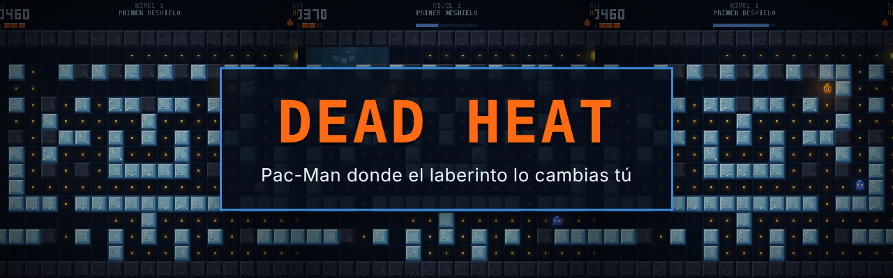
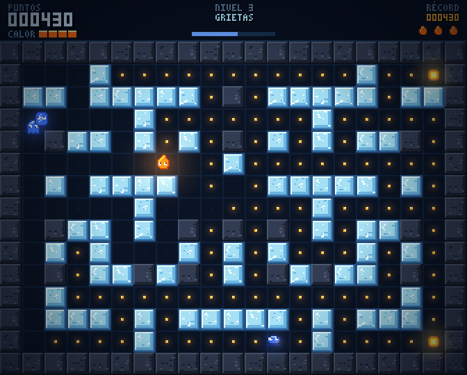
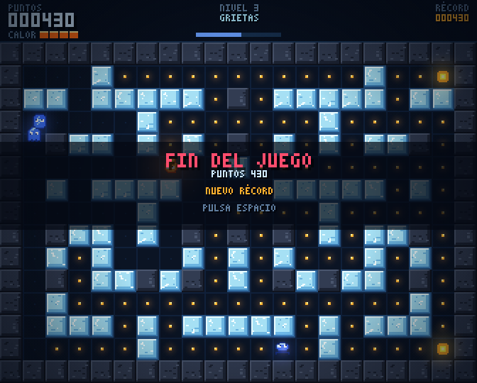
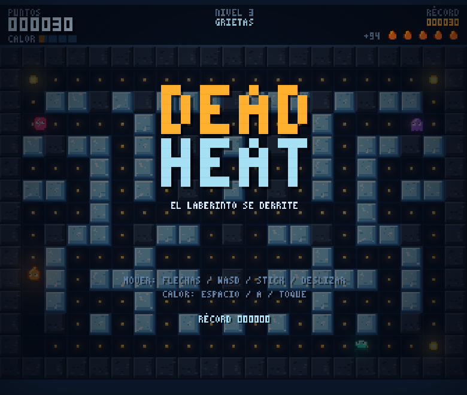
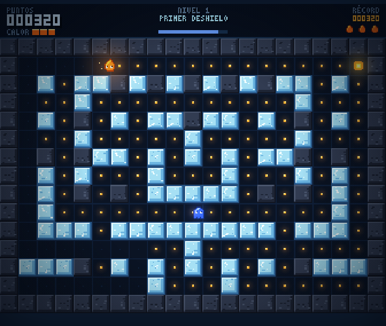
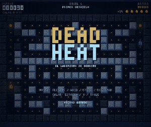
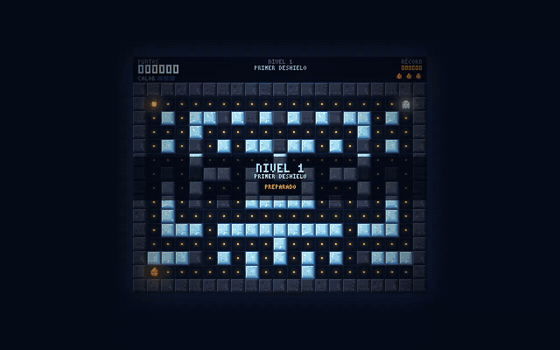

<div align="center">



# 🔥 Dead Heat

**Pac-Man donde el laberinto lo cambias tú.**
Recoges brasas para limpiar el nivel, y esas mismas brasas son tu herramienta: derriten los muros de hielo, abren atajos y sueltan agua que se vuelve contra los enemigos.

[](https://ivanchux.github.io/dead-heat/)


</div>

---

## 📑 Índice

[Qué es](#-qué-es) · [Capturas](#-capturas) · [En movimiento](#-en-movimiento) · [Cómo se juega](#-cómo-se-juega) · [Controles](#️-controles) · [Ejecutar y publicar](#-ejecutar-y-publicar) · [Estructura](#-estructura-del-repositorio) · [Pruebas](#-pruebas) · [Hoja de ruta](#️-hoja-de-ruta) · [Licencia](#-licencia)

## 🔥 Qué es

Dead Heat es un juego de laberinto en el que eres una llama pequeña dentro de un laberinto de hielo. Para pasar de nivel hay que recoger todas las brasas, y esas brasas se gastan para derretir muros y crear agua que cambia el mapa durante la partida.

- **Un único `index.html`**, sin dependencias ni archivos externos.
- Gráficos de **píxel art dibujados por código**; sonido y música sintetizados con Web Audio.
- Funciona con **teclado, mando y pantalla táctil**.
- Cinco niveles diseñados, tres enemigos y laberintos generados con semilla.
- El récord se guarda en el navegador.

## 📸 Capturas

<div align="center">

| Título | Partida |
|:---:|:---:|
|  |  |

| Agua | Poder |
|:---:|:---:|
|  |  |

| Grietas | Fin de partida |
|:---:|:---:|
|  |  |

 &nbsp; 

*En el móvil se juega deslizando el dedo y tocando para lanzar calor.*

</div>

## 🎬 En movimiento

<div align="center">

**Derretir un muro**


### 📱 En el móvil



### 🖥️ En el PC



*Los GIF de PC y móvil son una partida del primer nivel jugada por el piloto automático del propio juego.*

</div>

## 🎮 Cómo se juega

Eres una llama pequeña en un laberinto de hielo. Para pasar de nivel hay que recoger todas las brasas.

- **Brasas.** Cada una vale 10 puntos. Cada 5 brasas se carga una unidad de **calor**.
- **Calor.** Pulsa la acción para gastar una carga: derrite el primer bloque de hielo que tengas a dos casillas o menos en la dirección en que miras, y los cuatro bloques de hielo que lo rodean. La roca oscura no se derrite.
- **Agua.** El hielo derretido se convierte en agua que se reparte por los pasillos. Te frena un tercio, frena a los enemigos y hace correr más al patinador. Pasados unos segundos vuelve a congelarse, pero solo en casillas donde el laberinto sigue siendo recorrible entero. Así el mapa cambia durante la partida sin dejar nunca zonas aisladas.
- **Brasa grande.** Durante 7 segundos los enemigos se vuelven azules y lentos, y puedes comértelos (200, 400, 800 y 1600 puntos en cadena). También te da una carga de calor.
- **Calor contra enemigos.** Si la descarga alcanza a un enemigo sobre agua, se evapora (400 puntos). En seco, solo lo aturde 2,5 segundos. Un enemigo que pisa agua a punto de congelarse queda helado 4 segundos y no hace daño.
- **Vidas.** Empiezas con 3 vidas de reserva. Si pierdes la última, se acaba la partida. Completar un nivel da 500 puntos más 100 por cada vida de reserva.
- **Récord.** Se guarda en `localStorage` del navegador.

### 👾 Enemigos

| Enemigo | Color | Comportamiento |
|---|---|---|
| Gélido | Violeta | Te persigue por el camino más corto. Cada cierto tiempo se retira a su esquina. |
| Patinador | Verde | Se lanza en línea recta hasta chocar y elige entonces la dirección que más le acerca a ti. Sobre agua corre mucho más. |
| Grieta | Rosa | Merodea a media distancia. Cada pocos segundos marca una casilla cerca de ti y, tras un aviso parpadeante, la convierte en hielo. |

### 🗺️ Niveles

Cinco niveles diseñados, cada uno con más hielo, más enemigos y menos tiempo antes de que el agua se congele: Primer deshielo, Patinaje, Grietas, Cuarto frío y Calor muerto. Después, el último nivel se repite con velocidad creciente. Los laberintos se generan con semilla, son simétricos y siempre conexos.

## ⌨️ Controles

| Acción | Teclado | Mando | Táctil |
|---|---|---|---|
| Mover | Flechas, WASD | Stick o cruceta | Deslizar |
| Calor | Espacio, Z, X, Mayús | A, X, RB, RT | Tocar |
| Pausa | P, Esc | Start | (se pausa al salir de la pestaña) |
| Sonido | M | | |

## 🚀 Ejecutar y publicar

### Jugar en local

No hace falta instalar nada. Abre `index.html` en el navegador.

```bash
git clone https://github.com/Ivanchux/dead-heat.git
cd dead-heat
# abre index.html, o sirve la carpeta si prefieres:
python3 -m http.server 8000   # http://localhost:8000
```

### Publicar en GitHub Pages

1. Sube el repositorio a GitHub.
2. Ve a **Settings → Pages**.
3. En *Build and deployment* elige **Deploy from a branch**, rama `main` y carpeta `/ (root)`.
4. En un minuto estará en `https://ivanchux.github.io/dead-heat/`.

## 📁 Estructura del repositorio

`index.html` se genera a partir de `src/` con `python3 build.py`. Las fuentes se reparten por secciones para poder migrar a otro motor sin reescribir la lógica:

| Archivo | Contenido |
|---|---|
| `src/01-sim.js` | Generador de laberintos, datos de niveles y estado de partida. Sin dibujo, con semilla. |
| `src/02-step.js` | Paso fijo de simulación: movimiento, calor, agua, enemigos y colisiones. |
| `src/03-audio.js` | Efectos y música por capas con Web Audio. |
| `src/04-input.js` | Teclado, mando y táctil en una única capa de entrada. |
| `src/05-gfx.js` | Fuente de píxeles, sprites, baldosas y partículas. |
| `src/06-render.js` | Dibujado del mundo, luces y HUD. |
| `src/07-game.js` | Escenas, bucle, guardado y piloto automático. |

La simulación corre a 60 pasos por segundo independientes del dibujado y no depende del navegador, así que se puede ejecutar en Node para pruebas, repeticiones o modos con semilla compartida.

```text
dead-heat/
├── index.html        # El juego completo (generado, es lo único que hace falta para jugar)
├── src/              # Fuentes divididas por secciones (motor, audio, entrada, dibujo, juego)
├── build.py          # Genera index.html a partir de src/  (python3 build.py)
├── test/             # Pruebas en Node y Chromium
├── docs/             # Banner, capturas y GIFs de este README
├── CHANGELOG.md      # Historial de versiones
├── LICENSE           # PolyForm Noncommercial 1.0.0
└── README.md
```

## 🧪 Pruebas

Todo lo siguiente se ejecutó en un Chromium sin interfaz y en Node (`test/`):

- **Laberintos:** 4200 niveles generados (600 semillas × 7 niveles) sin una sola casilla de suelo aislada ni casilla sin salida.
- **Bots:** 30 partidas completas con un bot que esquiva enemigos y usa el calor. Completó 22, incluidos todos los del primer nivel. En ninguna hubo enemigos quietos más de un instante, suelo aislado ni enemigos encerrados, con unos 210 muros derretidos y 106 recongelados por tanda.
- **Controles:** 15 comprobaciones en el navegador (teclado, mando, deslizar y tocar, pausa, récord guardado y recuperado tras recargar, sonido).
- **Audio:** todos los efectos y la música se ejecutan sin errores.

### ⚠️ Lo que no está comprobado

- El tacto y la dificultad real. Los bots no juegan como una persona.
- Cómo suena el audio. Se comprobó que se ejecuta, no que suene bien.
- El mando y el táctil con dispositivos reales. Las pruebas usaron un mando simulado y eventos táctiles generados.
- Firefox, Safari y móviles.

## 🗺️ Hoja de ruta

1. **Fase 1 (esta):** núcleo jugable, cinco niveles, tres enemigos, sonido y controles.
2. **Fase 2:** ajuste de dificultad con partidas reales, jefes, menú de ajustes y remapeo de controles.
3. **Fase 3:** versus local para 2 a 4 jugadores en un laberinto que se derrite.
4. Después: modo diario con semilla, modo infinito y la preparación para Steam (logros, accesibilidad, Steam Deck).

## 📜 Licencia

El código y el arte están bajo **[PolyForm Noncommercial 1.0.0](LICENSE)**. Todo el código y los gráficos son originales de Iván (Ivanchux), sin elementos de terceros.

**Puedes, sin pedir permiso:**
- Jugarlo y compartir el enlace.
- Estudiar el código y modificarlo para uso personal, educativo o sin ánimo de lucro.
- Subirlo a otra web o a tu propio hosting, siempre gratis y sin anuncios, conservando el aviso de copyright y la licencia.
- Hacer streams, vídeos y capturas del juego, aunque tu canal esté monetizado.

**Necesitas mi permiso por escrito para:**
- Vender el juego, una copia o una versión modificada.
- Publicarlo en tiendas de aplicaciones o plataformas de juegos.
- Incluirlo en una web con anuncios, suscripciones o compras.

---

<div align="center">

Hecho con 🔥 por **[Ivanchux](https://github.com/Ivanchux)**

⭐ Si te ha gustado, deja una estrella al repositorio.

</div>
